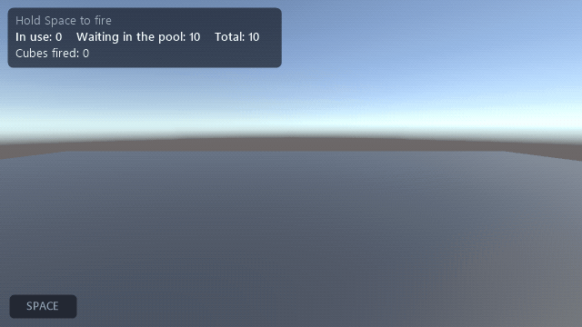
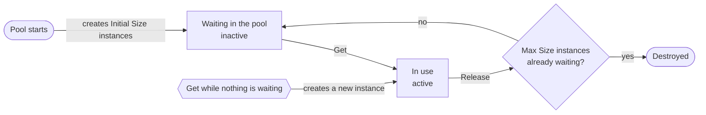

# Unity Object Pool

[](#tested-with)
[](https://github.com/Omerrgn/unity-object-pool/releases)
[](LICENSE)

A small GameObject pool for Unity that you set up in the Inspector: one `ObjectPool` component per prefab.



Instead of calling `Instantiate` and `Destroy` for every bullet, enemy or effect, you take an object from the pool and put it back when you are done with it. The pool deactivates the object and hands the same one out again next time.

- **Set up in the Inspector.** Add an Object Pool to any GameObject and give it a prefab; no pool code to write.
- **Grows when it runs out** and keeps what it created. **Max Size** limits how many instances it holds on to.
- **`IPoolable`** resets an instance between uses, **`PooledObject`** lets an instance send itself back.
- **Delayed release** that is cancelled when the instance comes back early.
- **Installs from the Package Manager**, comes with a sample scene and play mode tests.

[Türkçe özet aşağıda.](#türkçe)

## When it helps

Pooling pays off for objects that are created and destroyed often: bullets, waves of enemies, hit effects, floating damage numbers. The more often they spawn and the more components the prefab has, the more it saves.

It is not worth the extra code for objects that are created once (the player, the level) or a few times a minute. If you are not sure, look at the Profiler first.

## Installation

In Unity, open **Window → Package Manager**, click the **+** button, choose **Install package from git URL** and paste:

```
https://github.com/Omerrgn/unity-object-pool.git?path=/Packages/com.omerrgn.objectpool
```

Unity installs only the pool itself, not the rest of this repository. To stay on a particular version, append its tag to the address, for example `#v1.1.0`.

If you would rather not use the Package Manager, copy the `Packages/com.omerrgn.objectpool/Runtime` folder anywhere into the `Assets` folder of your project. It has no dependencies.

## Quick start

1. Add an **Object Pool** component to any GameObject in your scene.
2. Drag your prefab into its **Prefab** field and choose an **Initial Size**.
3. Reference the pool from the script that spawns the objects:

```csharp
using Omerrgn.ObjectPooling;
using UnityEngine;

public class Gun : MonoBehaviour
{
    [SerializeField] private ObjectPool bulletPool;

    public void Fire()
    {
        GameObject bullet = bulletPool.Get(transform.position, transform.rotation);
        bulletPool.Release(bullet, 3f); // goes back into the pool after three seconds
    }
}
```

`Get` returns the object active and already in place. `Release` deactivates it and makes it available again.

## How it works



Every instance moves between two states. While it waits in the pool it is inactive; `Get` activates it and hands it out, `Release` deactivates it and puts it back. After the start, the pool creates an instance only when nothing is waiting, and destroys one only when it already holds as many waiting instances as Max Size allows.

## How the size works

**Initial Size** is the number of instances the pool creates when it starts. It is not a limit.

| Initial Size is | What happens |
|---|---|
| higher than you ever need | The extra instances are never used. They cost memory and a slightly longer start, nothing else. |
| exactly what you need | No object is created during play. This is the goal. |
| lower than you need | When every instance is in use and another one is requested, the pool creates it on the spot, which is one `Instantiate` in the middle of play. It then keeps that instance like any other. |

So a pool that starts too small grows to the largest number of instances that were ever in use at the same time, and stays that size. It never shrinks on its own.

An example from the sample scene: the launcher fires 10 cubes per second and each cube lives for 2 seconds, so about 20 cubes are in use at once. Because the game moves on in whole frames, there can be one more in the air for a frame or two. With an Initial Size of 10 the pool creates the missing ones during roughly the first two seconds of firing and then stays at that size.

To find a good value, play your game through its busiest moment and read `CountAll` afterwards. That is the number to put into Initial Size.

**Max Size** is the largest number of instances the pool keeps waiting; 0 means no limit. `Get` never fails because of it: if every instance is in use, the pool still creates a new one. When an instance is released while Max Size instances are already waiting, it is destroyed instead of kept. Use it when a rare peak should not leave the pool holding that many objects for the rest of the game.

## Resetting objects with IPoolable

An object that comes back from the pool still has whatever its last use left behind: reduced health, a velocity, a target. Implement `IPoolable` on any component of the prefab to reset it:

```csharp
using Omerrgn.ObjectPooling;
using UnityEngine;

public class Enemy : MonoBehaviour, IPoolable
{
    [SerializeField] private int maxHealth = 100;
    private int _health;

    public void OnTakenFromPool()
    {
        _health = maxHealth;
    }

    public void OnReturnedToPool()
    {
    }
}
```

`OnTakenFromPool` is called right after the instance was activated, `OnReturnedToPool` right before it is deactivated. Components on child objects are called too.

`OnEnable` and `OnDisable` are not a good replacement. The pool creates each instance active and switches it off right away, so that `Awake` and its setup work happen while the pool is being filled rather than in the middle of play. As a side effect, `OnEnable` and `OnDisable` also run once when an instance is created, and again whenever a parent object is switched on or off.

## Releasing from the object itself with PooledObject

The pool adds a `PooledObject` component to every instance it creates. It knows which pool the instance came from, so a script on the instance can send it back without holding a reference to the pool:

```csharp
private void OnCollisionEnter(Collision collision)
{
    GetComponent<PooledObject>().Release();
}
```

You do not have to add `PooledObject` to the prefab. The pool adds it after the instance's `Awake` has run, so fetch it later than that, for example in `OnTakenFromPool`.

## API

| Member | What it does |
|---|---|
| `ObjectPool.Get()` | Returns an active instance, left where it was. |
| `ObjectPool.Get(position, rotation)` | Returns an active instance at the given position and rotation. |
| `ObjectPool.Release(instance)` | Puts an instance back into the pool. |
| `ObjectPool.Release(instance, delay)` | Puts an instance back after `delay` seconds. |
| `ObjectPool.CountActive` | Instances that are handed out right now. |
| `ObjectPool.CountInactive` | Instances waiting in the pool. |
| `ObjectPool.CountAll` | Both together. |
| `IPoolable.OnTakenFromPool()` | Called on the instance's components by `Get`. |
| `IPoolable.OnReturnedToPool()` | Called on the instance's components by `Release`. |
| `PooledObject.Pool` | The pool the instance belongs to. |
| `PooledObject.Release()`, `Release(delay)` | Same as calling `Release` on that pool. |

## Good to know

- Call `Release`, not `Destroy`. If a pooled instance is destroyed anyway, the pool notices and stops counting it, but the object is gone and a new one has to be created later.
- Releasing an object twice, or releasing an object that belongs to another pool, logs a warning and does nothing.
- If an `IPoolable` method throws, the exception is logged and the instance is still handed out or put back; the other components on it are still called.
- A delayed release is cancelled when the instance is released earlier or scheduled again. A bullet with a three second lifetime that hits something after one second will not be pulled back two seconds into its next flight.
- The pool times delayed releases itself, in its own `Update`, which runs before other scripts. An instance that is due back is therefore in the pool before another script asks for one in the same frame. While the pool's GameObject is inactive the timers wait; overdue instances go back as soon as it is active again.
- The instances live under an object named `Pool - <prefab name>` in the same scene as the pool, and are destroyed together with the pool. A pool marked `DontDestroyOnLoad` keeps its instances across scene loads; call `DontDestroyOnLoad` in `Awake` so that the pool can follow along.
- The pool initialises before other scripts, so calling `Get` from another script's `Awake` works.
- `IPoolable` components are looked up once, when an instance is created. Components added to an instance later are not called.

## How it compares to UnityEngine.Pool

Since version 2021 Unity ships its own `UnityEngine.Pool.ObjectPool<T>`. It is generic, works for any class and is driven entirely from code: you pass it the functions that create, activate, deactivate and destroy an object.

This repository does not try to replace it. It is an alternative for GameObjects only, set up in the Inspector without writing any pool code, and short enough to read in a few minutes. If you need to pool plain C# objects or want full control from code, use Unity's.

## The sample

The package comes with a sample scene. In the Package Manager, select **Object Pool**, open its **Samples** tab and click **Import** next to **Cube Launcher**. Unity copies the sample into `Assets/Samples/Object Pool/<version>/Cube Launcher`.

Open `ObjectPoolSample.unity` from there, press Play and hold Space. A launcher fires cubes that return to the pool on their own after two seconds. The cubes and the ground use the default material of whichever render pipeline your project has, Built-in, URP or HDRP.

The text in the corner shows the pool's counters and the number of cubes fired so far. Total settles at about 20 however long you keep firing, while the number of cubes fired keeps growing. Without a pool, each of those cubes would have been one `Instantiate` and one `Destroy`.

Select the `Launcher` object and change **Initial Size** and **Max Size** on its Object Pool component to see the behaviour described under [How the size works](#how-the-size-works).

## Running the tests

The package has play mode tests for the pool's behaviour: reuse, growing, Max Size, rejected releases, delayed releases, `IPoolable` and `PooledObject`. To run them, open this repository as a Unity project, then **Window → General → Test Runner → PlayMode → Run All**.

## Tested with

Requires Unity 6 (6000.0) or newer. Developed and tested with Unity 6000.3.20f1 and the Built-in Render Pipeline; the scripts do not depend on a render pipeline.

The sample reads the keyboard through the Input System package when it is active and through the old Input Manager otherwise.

## Türkçe

Unity için küçük bir obje havuzu. Her prefab için sahneye bir `ObjectPool` bileşeni eklenir ve Inspector'dan ayarlanır. Mermi, düşman ya da efekt gibi sık yaratılıp yok edilen objeleri her seferinde `Instantiate` ve `Destroy` ile üretmek yerine havuzdan `Get` ile alır, işiniz bitince `Release` ile geri verirsiniz.

Kurulum için Unity'de **Window → Package Manager** penceresini açın, **+** düğmesinden **Install package from git URL** seçeneğini seçip yukarıdaki adresi yapıştırın. Örnek sahneyi aynı pencerede paketin **Samples** sekmesinden alabilirsiniz.

**Initial Size** bir sınır değil, başlangıçta hazır edilen obje sayısıdır. Gereğinden büyükse fazla objeler yalnızca bellek harcar. Küçükse havuz eksik objeleri oyun sırasında yaratır, onları da elinde tutar ve kendiliğinden küçülmez. Doğru değeri bulmak için oyunun en yoğun anını oynayıp `CountAll` değerine bakın.

Ayrıntılar yukarıdaki İngilizce bölümlerde.

## License

[MIT](LICENSE)
